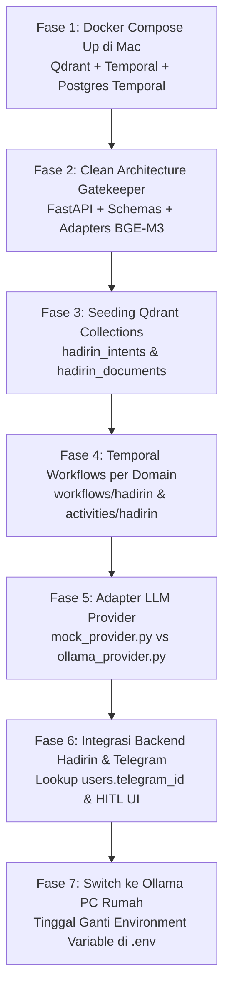

# 📋 IMPLEMENTATION PLAN: AI ORCHESTRATION HADIRIN (CLEAN ARCHITECTURE EDITION)
## Ekosistem Anak-Pintar — Platform Hadirin (Workforce & Smart Attendance)
**Referensi Acuan**: `26_DOKUMENTASI_API_AI_ORCHESTRATION_KERJACERDAS.md` & `AI orchestration.png`  
**Standar Arsitektur**: 100% Clean Code, Clean Architecture & Domain-Driven Design (DDD)  
**Target Lingkungan Awal**: Laptop Mac (Docker Desktop aktif: Qdrant + Temporal + FastEmbed BGE-M3 + Mock LLM Adapter)  
**Target Akhir**: Hybrid Edge AI (Model Qwen 2.5 di PC Lokal via Ollama + Shared Core)  
**Status**: Ready for Execution (Pre-LLM Phase — Docker Siap)

---

## 1. Ringkasan Eksekutif & Prinsip Clean Architecture

Sistem **AI Orchestration Hadirin** mengadopsi 100% pola desain enterprise dari sistem **Kerja Cerdas**, yang memisahkan proses AI menjadi lapisan deterministik (*deterministic pre-processing*) dan lapisan penalaran (*LLM reasoning*).

Dokumen ini telah direvisi secara komprehensif mengikuti standar **Clean Architecture (Robert C. Martin / Uncle Bob)** dan **Domain-Driven Design (DDD)** dengan pilar utama:
1. **Separation of Concerns (SoC):** Pemisahan tegas antara *Delivery Layer* (FastAPI/HTTP), *Application Layer* (Temporal Workflows), *Domain Layer* (Aturan Cuti & Roster HR), dan *Infrastructure/Adapters Layer* (Qdrant, BGE-M3, Ollama).
2. **Dependency Inversion Principle (DIP):** Modul tingkat tinggi (domain & workflow) tidak bergantung langsung pada implementasi teknis eksternal (LLM atau Vector DB). Komponen eksternal dibungkus dalam **Adapter Pattern** (`adapters/llm/base.py`), sehingga perpindahan dari Mock Simulator di Mac ke Ollama di PC rumah (atau ke Cloud API di masa depan) mematuhi **Open/Closed Principle (OCP)** tanpa mengubah logika bisnis.
3. **Deterministic Identity Resolution via `users.telegram_id`:** Zero AI Guesswork untuk identitas pengirim pesan Telegram. Gateway mengunci identitas karyawan, tenant, divisi, dan kuota cuti via query database sebelum masuk ke pipeline AI.
4. **Shared Multi-Domain Core:** Folder `AI-shared-orchestration` dirancang modular untuk melayani platform **Hadirin** saat ini dan platform **LISA** di masa depan tanpa duplikasi kontainer infrastruktur.

---

## 2. Arsitektur Pra-LLM AI Orchestration Hadirin

```
+---------------------------------------------------------------------------------------------------+
|                        ARSITEKTUR CLEAN CODE AI ORCHESTRATION HADIRIN                             |
|                                                                                                   |
|  [ Hadirin Web Client (React/Vite) ]        [ Telegram Chat / Group ]                             |
|            │                                           │ (Webhook HTTPS)                          |
|            │                                           ▼                                          |
|            │                          [ Telegram Gateway (Deterministic Identity) ]               |
|            │                          Lookup: SELECT * FROM users WHERE telegram_id = ?           |
|            │                          (Resolve: user_id, tenant_id, role, department)             |
|            │                                           │                                          |
|            └───────────────────┬───────────────────────┘                                          |
|                                ▼ (HTTP POST)                                                      |
|  [ LAYER 1: RAG & Intent Gatekeeper Service (FastAPI Port 8000) ]                                 |
|     ├── Presentation / API      : /api/v1/gatekeeper (/process-input, /detect-intent)             |
|     ├── Data Contracts (DTO)    : schemas/ (Pydantic validation for Request & TemporalPayload)    |
|     ├── Domain Logic (Pure HR)  : domains/hadirin/ (Intent rules, leave policies, prompt builder) |
|     └── Adapters Layer (DIP)    : adapters/ (Qdrant VectorStore, BGE-M3 Embedder, LLM Provider)   |
|            │                                                                                      |
|            ▼ (Prepared Contract Payload)                                                          |
|  [ LAYER 2: Temporal Orchestration Engine (Port 7233) ]                                           |
|     ├── workflows/hadirin/      : LeaveRequestWorkflow, OvertimeWorkflow (Saga State Machines)    |
|     ├── activities/hadirin/     : ValidateQuotaActivity, NotifyLeaderActivity, DB Commit         |
|     └── activities/common/      : InvokeLLMActivity (Adapter call to Mock / Ollama)               |
|            │                                                                                      |
|            ▼ (HTTP Prompt Contract)                                                               |
|  [ LAYER 3: LLM Adapter & Staging Interface ]                                                     |
|     ├── FASE A (Saat ini di Mac)  : mock_provider.py (Instant deterministic JSON simulation)      |
|     └── FASE B (Saat PC Siap)    : ollama_provider.py (Qwen 2.5 7B di Port 11434 via .env switch) |
|            │                                                                                      |
|            ▼ (Atomic Commit & Notification)                                                       |
|  [ LAYER 4: Database & Business Interface ]                                                       |
|     ├── MySQL Hadirin (Port 3306) : System of Record (users, attendance, leaves, shifts, roles)  |
|     └── Hadirin Backend / UI      : Notifikasi Kartu Approval Interaktif (HITL)                   |
+---------------------------------------------------------------------------------------------------+
```

---

## 2.1 Mekanisme Resolusi Identitas via Kolom `users.telegram_id`

Prinsip mutlak arsitektur enterprise: **Zero AI Guesswork** untuk identitas pengguna. Sistem tidak mengizinkan model bahasa menebak siapa pengirim pesan.

### Alur Kerja Deterministic Identity:
1. **Pesan Masuk dari Telegram:**
   Karyawan mengirim pesan di grup atau chat bot Telegram. Telegram menyertakan payload `message.from.id` (misal: `58821901`).
2. **Pengecekan ke MySQL Hadirin:**
   Sebelum masuk ke pemrosesan AI, Gateway melakukan query deterministik:
   ```sql
   SELECT u.id, u.name, u.tenant_id, u.department, u.role_id, r.code AS role_code,
          u.remaining_leave_quota, u.telegram_id
   FROM users u
   LEFT JOIN roles r ON u.role_id = r.id
   WHERE u.telegram_id = '58821901' AND u.deleted_at IS NULL
   LIMIT 1;
   ```
3. **Cabang Keputusan:**
   * **Kasus A (Belum Tertaut):** Jika `telegram_id` tidak ditemukan di database, bot langsung merespons deterministik:  
     > *"⚠️ Akun Telegram Anda belum ditautkan ke akun Hadirin. Silakan hubungkan Telegram ID Anda melalui menu Profil di aplikasi Hadirin Web."*  
     *(Proses berhenti di sini: menghemat 100% komputasi AI & mencegah akses ilegal).*
   * **Kasus B (Valid & Terverifikasi):** Identitas karyawan terkunci mutlak (`user_id = usr-doni-01`, `tenant_id = TENANT-001`, `quota = 8`). Data kontekstual ini disisipkan ke dalam `metadata` payload untuk dikirim ke endpoint `/api/v1/gatekeeper/process-input`.

---

## 3. Spesifikasi Kontrak API Gatekeeper (Layer 1 - Port 8000)

Sesuai standar spesifikasi `26_DOKUMENTASI_API_AI_ORCHESTRATION_KERJACERDAS.md`, berikut adaptasi kontrak endpoint yang telah distandardisasi dengan Pydantic schemas:

### 3.1 `POST /api/v1/gatekeeper/process-input` (End-to-End Gatekeeper)
* **Fungsi**: Titik masuk utama pesan dari Web Chat atau Telegram Gateway. Menyaring obrolan umum, mengidentifikasi intensi cuti/izin/lembur, menyematkan data hasil resolusi `telegram_id`, dan merangkai payload Temporal.
* **Request Payload**:
```json
{
  "id": "msg-telegram-99201",
  "text": "Pak Bambang, saya mau izin cuti tahunan tanggal 24 dan 25 Oktober besok ada acara nikahan adik di Jogja",
  "source": "telegram",
  "metadata": {
    "telegram_id": "58821901",
    "user_id": "usr-doni-01",
    "sender_name": "Doni Pradana",
    "tenant_id": "TENANT-001",
    "department": "IT Support",
    "role": "EMPLOYEE"
  },
  "threshold": 0.78
}
```
* **Response Payload (Lolos Filter - Siap Eksekusi Temporal)**:
```json
{
  "status": "processed_and_queued",
  "action": "TRIGGER_WORKFLOW",
  "document_id": "msg-telegram-99201",
  "collection": "hadirin_documents",
  "intent": "ANNUAL_LEAVE_REQUEST",
  "confidence": 0.8921,
  "is_actionable": true,
  "target_workflow": "LeaveRequestWorkflow",
  "workflow_status": "QUEUED_CONTRACT_READY",
  "workflow_id": "wf-leave-usr-doni-01-20261024",
  "node_7_augmented_prompt": {
    "employee": "Doni Pradana (usr-doni-01)",
    "telegram_id": "58821901",
    "department": "IT Support",
    "active_shift": "Non-Shift (08:00 - 17:00)",
    "remaining_leave_quota": 8,
    "matched_leave_type": {
      "code": "ANNUAL_LEAVE",
      "name": "Cuti Tahunan",
      "requires_attachment": false
    },
    "team_capacity_context": {
      "total_team_members": 5,
      "on_leave_at_date": 0,
      "projected_capacity": "100%"
    },
    "system_instruction": "Ekstrak tanggal dan alasan ke dalam JSON sesuai leave_request_schema.json..."
  },
  "temporal_payload": {
    "workflow_name": "LeaveRequestWorkflow",
    "workflow_id": "wf-leave-usr-doni-01-20261024",
    "task_queue": "HADIRIN_HR_QUEUE",
    "input": {
      "user_id": "usr-doni-01",
      "telegram_id": "58821901",
      "tenant_id": "TENANT-001",
      "intent": "ANNUAL_LEAVE_REQUEST",
      "raw_text": "Pak Bambang, saya mau izin cuti tahunan tanggal 24 dan 25 Oktober besok ada acara nikahan adik di Jogja",
      "augmented_context": { ... }
    }
  }
}
```
* **Response Payload (Noise Operasional / Diabaikan)**:
Jika staf mengirim: *"pagi all, dispenser air galon di pantry lantai 2 habis ya"*
```json
{
  "status": "ignored",
  "action": "IGNORE_NOISE",
  "intent": "FACILITY_CHATTER",
  "confidence": 0.8654,
  "is_actionable": false,
  "reason": "Pesan teridentifikasi sebagai obrolan umum/fasilitas kantor. Tidak memicu alur cuti/presensi.",
  "target_workflow": null,
  "temporal_payload": null
}
```

---

### 3.2 `POST /api/v1/gatekeeper/detect-intent` (Dynamic Semantic Intent Classifier)
* **Fungsi**: Klasifikasi semantik independen menggunakan embedding BGE-M3 (1024-dimensi) terhadap koleksi `hadirin_intents` di Qdrant.
* **Daftar Intensi Terdaftar di Hadirin**:
  1. `ANNUAL_LEAVE_REQUEST` (Pengajuan cuti tahunan)
  2. `SICK_LEAVE_REPORT` (Izin sakit dengan/tanpa surat dokter)
  3. `OVERTIME_CLAIM` (Pengajuan/klaim jam lembur)
  4. `SHIFT_SWAP_REQUEST` (Permohonan pertukaran jadwal shift antar rekan)
  5. `ATTENDANCE_STATUS_QUERY` (Tanya riwayat presensi/jam masuk/sisa cuti)
  6. `POLICY_HR_QUERY` (Tanya aturan SOP/Peraturan Perusahaan)
  7. `CASUAL_CHATTER` (*Non-actionable noise* / sapaan umum)

---

### 3.3 `POST /api/v1/prompts/build-augmented-prompt` (Context Fusion Engine)
* **Fungsi**: Menggabungkan teks pengguna asli dengan data relasional MySQL hasil resolusi `telegram_id` (kuota cuti, jadwal roster shift, riwayat absensi, hirarki atasan langsung) dan aturan baku perusahaan sebelum menghasilkan prompt akhir.
* **Prinsip Zero Hardcode**: Format instruksi dan batasan wewenang dirangkum secara dinamis berdasarkan data tenant.

---

## 4. Rincian Tahapan Implementasi (Step-by-Step Roadmap)



### 🔹 FASE 1: Menjalankan Docker Infrastructure di Laptop Mac (Siap Eksekusi)
Karena Docker Desktop sudah terinstal aktif di Mac Anda:
1. Buat direktori **`AI-shared-orchestration/`** di root ekosistem.
2. Buat file `AI-shared-orchestration/docker-compose.yml`:
   * **`qdrant`**: Image `qdrant/qdrant:latest` (Port 6333 untuk REST/Web UI, 6334 untuk gRPC).
   * **`temporal-db`**: PostgreSQL 16 Alpine ringan (Port 5433) khusus internal Temporal.
   * **`temporal`**: Image `temporalio/auto-setup:latest` (Port 7233).
   * **`temporal-ui`**: Image `temporalio/ui:latest` (Port 8088).
3. Jalankan `docker compose up -d` dan verifikasi:
   * Qdrant Dashboard: `http://localhost:6333/dashboard`
   * Temporal Web UI: `http://localhost:8088`

### 🔹 FASE 2: Membangun Clean RAG Gatekeeper Service (FastAPI Port 8000)
Mengembangkan service Python FastAPI di `AI-shared-orchestration/rag-gatekeeper/`:
1. **Setup Dependencies (`requirements.txt`)**:
   * `fastapi`, `uvicorn`, `qdrant-client`, `pydantic`, `pydantic-settings`.
   * `fastembed` (Menjalankan model **BAAI/bge-m3** secara lokal di CPU Mac dengan akselerasi ONNX Runtime, sangat cepat <35ms dan hemat RAM).
2. **Implementasi Lapisan Bersih (Clean Layers)**:
   * **`app/schemas/`**: Pydantic models DTO untuk validasi ketat request dan response (`intent.py`, `process_input.py`, `common.py`).
   * **`app/adapters/`**:
     * `vectorstore/qdrant_adapter.py`: Wrapper client Qdrant dan inisialisasi koleksi Cosine Distance.
     * `embedding/bge_m3_adapter.py`: Wrapper FastEmbed BGE-M3 (output vektor 1024-dimensi).
   * **`app/domains/hadirin/`**: Logika bisnis murni (`intents.py`, `prompt_builder.py`, `rules.py`).
   * **`app/api/v1/`**: Delivery endpoints (`gatekeeper.py`, `prompts.py`, `health.py`).
3. Verifikasi performa inferensi embedding di Mac: pastikan latensi vektorisasi teks di bawah 50 milidetik.

### 🔹 FASE 3: Seeding Koleksi Intensi & Aturan Hadirin
1. Jalankan skrip `scripts/seed_qdrant_hadirin.py`:
   * Koleksi `hadirin_intents`: Membaca dataset dari `knowledge-base/hadirin/anchor_phrases.json` (50+ variasi frase percakapan informal Indonesia untuk setiap kategori: Cuti Tahunan, Cuti Sakit, Lembur, Tukar Shift, dan Obrolan Santai).
   * Koleksi `hadirin_documents`: Membaca SOP & Aturan Depnaker dari `knowledge-base/hadirin/company_leave_policies.json` (vektorisasi batas lembur 14 jam/minggu, syarat surat dokter jika sakit >1 hari).

### 🔹 FASE 4: Membangun State Machine Temporal Berpartisi Domain (Port 7233)
Mengembangkan *workflow* dan *activities* di `AI-shared-orchestration/temporal-workflows/`:
1. **Definisi Workflow Domain Hadirin (`workflows/hadirin/leave_request_workflow.py`)**:
   * Input: Data karyawan (termasuk hasil resolusi `telegram_id`), tanggal, alasan, dan augmented context.
   * Activity 1: `invoke_llm_activity` (Menghasilkan JSON draf pengajuan).
   * Activity 2: `validate_quota_activity` (Mengecek sisa kuota cuti di MySQL Hadirin, anti self-approval).
   * Activity 3: `commit_leave_activity` (Menulis draf ke tabel `leaves` dengan status `PENDING`).
   * Activity 4: `notify_leader_activity` (Kirim notifikasi kartu approval ke atasan).
2. **Definisi Workflow Lembur (`workflows/hadirin/overtime_workflow.py`)**:
   * Memvalidasi jam lembur tidak bentrok dengan shift berikutnya.
3. Menjalankan Temporal Worker lokal di Mac (`python worker.py`).

### 🔹 FASE 5: Menyiapkan Adapter LLM Provider (Dependency Inversion)
Menerapkan **Adapter Pattern** di `rag-gatekeeper/app/adapters/llm/` sehingga kode domain tidak bergantung pada satu engine LLM tertentu:
1. **Interface Abstrak (`base.py`)**:
   ```python
   from abc import ABC, abstractmethod
   from typing import Dict, Any

   class BaseLLMProvider(ABC):
       @abstractmethod
       async def extract_structured_json(self, prompt: str, schema: Dict[str, Any]) -> Dict[str, Any]:
           pass
   ```
2. **Provider Mock (`mock_provider.py`)**:
   * Digunakan saat ini selama di laptop Mac (tanpa GPU).
   * Mengembalikan objek JSON valid instan (0.01 detik) sesuai skema `leave_request_schema.json`:
     ```json
     {
       "leave_type": "ANNUAL",
       "start_date": "2026-10-24",
       "end_date": "2026-10-25",
       "total_days": 2,
       "reason": "Acara pernikahan keluarga di Jogja"
     }
     ```
3. **Provider Ollama (`ollama_provider.py`)**:
   * Siap digunakan begitu Ollama diinstal di PC rumah dengan memanggil endpoint OpenAI-compatible `/v1/chat/completions`.
4. **Factory Resolver di `config.py`**:
   Sistem memilih provider secara otomatis berdasarkan konfigurasi `.env`:
   ```env
   LLM_PROVIDER=mock       # Opsi: mock | ollama | gemini
   OLLAMA_BASE_URL=http://localhost:11434/v1
   ```

### 🔹 FASE 6: Integrasi Gateway Telegram & Backend Hadirin (Node.js Express)
Menghubungkan aplikasi web dan bot Telegram Hadirin yang sudah ada:
1. **Telegram Webhook Handler (`hadiri/backend/src/interfaces/telegram`)**:
   * Tangkap pesan Telegram: ambil `message.from.id` (ID Telegram pengirim).
   * Query database MySQL: `SELECT * FROM users WHERE telegram_id = ?`.
   * Jika tidak ada: balas dengan pesan penautan akun.
   * Jika ada: teruskan ke `http://localhost:8000/api/v1/gatekeeper/process-input` dengan metadata karyawan yang valid.
2. **Backend Hadirin (`hadiri/backend`)**:
   * Tambahkan service `aiOrchestratorService.js` yang memanggil endpoint Gatekeeper.
   * Buat endpoint `/api/assistant/chat` untuk menerima pesan dari UI web karyawan.
3. **Frontend Hadirin (`hadiri/frontend`)**:
   * Tambahkan widget/drawer percakapan interaktif (*AI Copilot Drawer*).
   * Karyawan dapat mengetik pesan pengajuan cuti secara natural dan langsung melihat kartu konfirmasi tanpa mengisi form panjang.

### 🔹 FASE 7: Transisi ke Ollama di PC Rumah (Saat Hardware Siap)
Ketika Anda siap menginstal Ollama di PC rumah:
1. Di PC rumah, jalankan:
   ```bash
   ollama pull qwen2.5:7b
   ollama run qwen2.5:7b
   ```
2. Di file `.env` sistem orkestrasi `AI-shared-orchestration`:
   * Ubah `LLM_PROVIDER=ollama`.
   * Arahkan `OLLAMA_BASE_URL=http://<IP_PC_RUMAH>:11434/v1` (atau `http://host.docker.internal:11434/v1`).
3. **Seluruh sistem langsung aktif 100% dengan kecerdasan AI asli tanpa mengubah 1 baris kode bisnis pun!**

---

## 5. Struktur Folder 100% Clean Code & Clean Architecture

```text
anak-pintar (AI Echosistem)/
│
├── master context/
│   ├── 1. macro master context.txt
│   ├── 2. micro master context.txt
│   ├── 3. master context diagram and tech-stack.txt
│   ├── 4. implementation plan ai orchestration.md    <-- (Dokumen Ini)
│   └── AI orchestration.png
│
├── AI-shared-orchestration/                            <-- Service Orkestrasi Bersama (Hadirin & LISA)
│   ├── docker-compose.yml                              # Orkestrasi Infrastruktur (Qdrant + Temporal + DB)
│   ├── .env.example
│   ├── README.md
│   │
│   ├── rag-gatekeeper/                                 # [Layer 1: FastAPI Gatekeeper - Port 8000]
│   │   ├── app/
│   │   │   ├── config.py                               # Konfigurasi Environment & App Settings
│   │   │   │
│   │   │   ├── schemas/                                # [Data Transfer Objects / Pydantic Models]
│   │   │   │   ├── common.py                           # Schema dasar (BaseResponse, Metadata, Error)
│   │   │   │   ├── intent.py                           # Schema DetectIntentRequest & Response
│   │   │   │   └── process_input.py                    # Schema ProcessInputRequest & TemporalPayload
│   │   │   │
│   │   │   ├── adapters/                               # [Infrastructure / Adapters - Dependency Inversion]
│   │   │   │   ├── vectorstore/
│   │   │   │   │   └── qdrant_adapter.py               # Wrapper resmi Qdrant Client & Koleksi
│   │   │   │   ├── embedding/
│   │   │   │   │   └── bge_m3_adapter.py               # Wrapper FastEmbed BGE-M3 (1024-dim)
│   │   │   │   └── llm/                                # [Adapter Pattern untuk LLM]
│   │   │   │       ├── base.py                         # Interface / Abstract Base Class LLM
│   │   │   │       ├── mock_provider.py                # Provider Mock (Digunakan saat ini di Mac)
│   │   │   │       └── ollama_provider.py              # Provider Ollama (Digunakan di PC Rumah nanti)
│   │   │   │
│   │   │   ├── domains/                                # [Domain Business Logic - Zero Infrastructure]
│   │   │   │   ├── hadirin/                            # Domain Hadirin (Workforce & HR)
│   │   │   │   │   ├── intents.py                      # Definisi taksonomi intensi cuti/presensi
│   │   │   │   │   ├── prompt_builder.py               # Context fusion (roster, kuota, aturan)
│   │   │   │   │   └── rules.py                        # Aturan bisnis cuti & limit lembur
│   │   │   │   └── lisa/                               # Domain LISA (Gold Investment)
│   │   │   │       ├── intents.py                      # Definisi taksonomi intensi emas
│   │   │   │       └── prompt_builder.py               # Context fusion (harga pasar, portofolio)
│   │   │   │
│   │   │   ├── api/                                    # [Presentation / Delivery Layer]
│   │   │   │   └── v1/
│   │   │   │       ├── endpoints/
│   │   │   │       │   ├── gatekeeper.py               # Endpoint /process-input & /detect-intent
│   │   │   │       │   ├── prompts.py                  # Endpoint /build-augmented-prompt
│   │   │   │       │   └── health.py                   # Endpoint /health
│   │   │   │       └── router.py                       # Aggregator Router API v1
│   │   │   │
│   │   │   └── main.py                                 # Application Entrypoint FastAPI
│   │   ├── requirements.txt
│   │   └── Dockerfile
│   │
│   ├── temporal-workflows/                             # [Layer 2: Temporal Orchestration Engine - Port 7233]
│   │   ├── workflows/                                  # [State Machines dipartisi per Domain]
│   │   │   ├── hadirin/
│   │   │   │   ├── leave_request_workflow.py
│   │   │   │   └── overtime_workflow.py
│   │   │   └── lisa/
│   │   │       └── gold_price_cron_workflow.py
│   │   │
│   │   ├── activities/                                 # [Atomic Activities]
│   │   │   ├── hadirin/
│   │   │   │   ├── validate_quota_activity.py          # Cek ke MySQL Hadirin
│   │   │   │   ├── commit_leave_activity.py            # Insert ke tabel leaves status PENDING
│   │   │   │   └── notify_leader_activity.py           # Kirim kartu approval
│   │   │   └── common/
│   │   │       └── invoke_llm_activity.py              # Panggil LLM (Mock atau Ollama)
│   │   │
│   │   ├── worker.py                                   # Temporal Worker Entrypoint
│   │   └── requirements.txt
│   │
│   ├── knowledge-base/                                 # [Master Data & Knowledge Docs]
│   │   ├── hadirin/
│   │   │   ├── company_leave_policies.json             # SOP Cuti & Aturan Depnaker
│   │   │   └── anchor_phrases.json                     # 50+ variasi frase percakapan cuti
│   │   └── lisa/
│   │       └── gold_glossary.json
│   │
│   └── scripts/                                        # [DevOps & Database Seeding Tools]
│       ├── seed_qdrant_hadirin.py                      # Skrip inisialisasi koleksi & embedding Qdrant
│       └── test_pre_llm_pipeline.py                    # Automated integration test pra-LLM
│
├── hadiri/                                             # Proyek Hadirin (Frontend React + Backend Node.js)
│   ├── backend/
│   │   ├── src/database/mysql.js                       # Skema users memiliki kolom telegram_id
│   │   ├── src/interfaces/telegram/                    # Gateway: Lookup telegram_id -> metadata
│   │   └── src/services/aiOrchestratorService.js       # Client pemanggil Layer 1 Gatekeeper
│   └── frontend/
│       └── src/components/ai-assistant/                # Komponen UI Chat Copilot
│
└── lisa/                                               # Proyek LISA (Ekspansi Masa Depan)
```

---

## 6. Checklist Verifikasi Sukses Fase Pra-LLM

Sebelum beralih ke instalasi model Ollama di PC rumah, pastikan pengujian berikut lulus 100%:

- [x] **Docker Containers Aktif**: Qdrant (`:6333`) dan Temporal Web (`:8088`) berjalan normal via `AI-shared-orchestration/docker-compose.yml`.
- [ ] **Resolusi `telegram_id` Berhasil**: Pesan Telegram dari ID yang terdaftar otomatis mendeteksi profil karyawan, sedangkan ID tidak terdaftar ditolak dengan arahan penautan akun.
- [x] **Gatekeeper Latency < 50ms**: Panggilan `POST /api/v1/gatekeeper/detect-intent` menghasilkan klasifikasi akurat dengan waktu respon di bawah 50ms menggunakan FastEmbed BGE-M3.
- [x] **Noise Filtering Lulus**: Pesan percakapan umum/fasilitas (*"dispenser air rusak"*) menghasilkan status `ignored`, sedangkan pesan izin cuti menghasilkan status `processed_and_queued`.
- [ ] **Temporal Resilient Execution**: Workflow berhasil dieksekusi oleh Temporal Worker; saat worker dimatikan paksa di tengah jalan lalu dinyalakan lagi, workflow tetap selesai secara idempotent.
- [x] **Mock LLM Contract Valid**: Output JSON dari `mock_provider.py` mematuhi 100% skema data cuti/lembur Hadirin.
- [ ] **End-to-End Test dari Hadirin UI & Telegram**: Mengetik permohonan cuti berhasil menciptakan data pengajuan baru berstatus `PENDING` di MySQL dengan catatan kalkulasi kapasitas tim yang akurat.

---
*Rencana implementasi Clean Architecture ini siap dieksekusi.*
